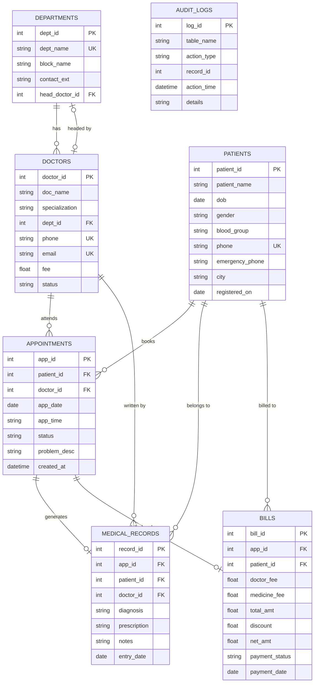

# BCSE302L - Database Systems Course Project Report

**Project Title:** Hospital Management System  
**Course Code:** BCSE302L  
**Slot / Batch:** Winter Semester 2024–2025  
**School:** School of Computer Science Engineering and Information Systems (SCOPE), VIT  

---

## 1. Student Details

* **Student Name:** Kankanala Havish Kumar
* **Registration Number:** 24BYB0057
* **Project Type:** Individual Course Project (Single Member)
* **School:** School of Computer Science Engineering and Information Systems (SCOPE), VIT

---

## 2. Introduction & Problem Statement

### 2.1 Introduction
In small to mid-sized hospitals and clinics, handling patient registrations, doctor appointment slots, prescriptions, and billing on paper registers or separate Excel files causes multiple problems. Records easily get misplaced, doctors get double-booked for the same time slot, and there is no reliable way to track pending bills or maintain an audit trail when appointments are cancelled. 

This project implements a relational database system in SQL with Python connectivity to handle daily hospital workflows systematically.

### 2.2 Problem Statement
1. **Double Booking of Doctors:** Without checks, two patients can be scheduled for the same doctor at the same hour.
2. **Disconnected Billing:** Medication costs and doctor fees are often manually calculated on paper, leading to calculation mistakes and missing discounts.
3. **Missing Audit Logs:** When appointments are cancelled, staff often delete or overwrite rows, leaving no record of who cancelled and when.
4. **Tracking Unpaid Invoices:** No automated way to list patients with pending dues.

### 2.3 Proposed System
The system contains 7 relational tables (`departments`, `doctors`, `patients`, `appointments`, `medical_records`, `bills`, `audit_logs`). It includes:
* Validation procedures to ensure slots are not double-booked.
* Automatic billing triggers to calculate total and net amounts.
* Database triggers that record cancellations into an audit log.
* Stored functions to check doctor revenue and patient visit counts.
* An interactive Python application to run queries, test transactions, and manage records.

---

## 3. Functional Requirements

1. **Department & Doctor Management:** Store hospital departments with building block numbers, extensions, and assigned head doctors. Doctors have fees, specialties, and active statuses.
2. **Patient Records:** Capture patient name, DOB, blood group, contact, emergency contact, and hometown.
3. **Appointment Scheduling:** Book appointments between patients and doctors with date and time checks (`Scheduled`, `Completed`, `Cancelled`, `No-Show`).
4. **Consultations & Records:** Record diagnosis, prescribed medicines, and doctor notes for completed visits.
5. **Billing Module:** Automatically compute total bills from doctor fees and medication charges, apply discounts, and manage payment statuses (`Paid`, `Pending`).
6. **Audit Trail:** Maintain an automated log table for critical updates and cancellations.

---

## 4. Entity-Relationship (ER) Diagram

### 4.1 ER Diagram



### 4.2 Cardinality
* `departments` to `doctors`: $1 : N$ (One department has many doctors).
* `patients` to `appointments`: $1 : N$ (A patient can book multiple appointments over time).
* `doctors` to `appointments`: $1 : N$ (A doctor attends multiple appointments).
* `appointments` to `medical_records`: $1 : 1$ (Each completed visit has one clinical record).
* `appointments` to `bills`: $1 : 1$ (Each appointment generates one bill invoice).

---

## 5. Relational Schema (in 3NF)

All tables are in **Third Normal Form (3NF)**:
1. **`departments`** (<u>dept_id</u>, dept_name, block_name, contact_ext, *head_doctor_id* $\rightarrow$ doctors)
2. **`doctors`** (<u>doctor_id</u>, doc_name, specialization, *dept_id* $\rightarrow$ departments, phone, email, fee, status)
3. **`patients`** (<u>patient_id</u>, patient_name, dob, gender, blood_group, phone, emergency_phone, city, registered_on)
4. **`appointments`** (<u>app_id</u>, *patient_id* $\rightarrow$ patients, *doctor_id* $\rightarrow$ doctors, app_date, app_time, status, problem_desc, created_at)
5. **`medical_records`** (<u>record_id</u>, *app_id* $\rightarrow$ appointments, *patient_id* $\rightarrow$ patients, *doctor_id* $\rightarrow$ doctors, diagnosis, prescription, notes, entry_date)
6. **`bills`** (<u>bill_id</u>, *app_id* $\rightarrow$ appointments, *patient_id* $\rightarrow$ patients, doctor_fee, medicine_fee, total_amt, discount, net_amt, payment_status, payment_date)
7. **`audit_logs`** (<u>log_id</u>, table_name, action_type, record_id, action_time, details)

---

## 6. Table Creation and Constraints (DDL)

The schema enforces domain, entity, and referential constraints:
* **Primary Keys:** On each table to identify records uniquely.
* **Foreign Keys:** Enforce relationships with `ON DELETE CASCADE` where child records depend directly on parent records.
* **NOT NULL:** Enforced on names, dates, phone numbers, and fees.
* **UNIQUE:** Applied on emails, contact numbers, and department names.
* **CHECK Constraints:** Validates that fees $\ge 0$, discounts $\ge 0$, genders are valid (`Male`, `Female`, `Other`), blood groups match standard values, and statuses follow allowed lists (`Scheduled`, `Completed`, `Cancelled`, `No-Show`).

---

## 7. SQL Queries and Outputs (15 Queries)

### Query 1: Join Appointment, Patient, Doctor, and Department
```sql
SELECT a.app_id, p.patient_name, d.doc_name, dep.dept_name, a.app_date, a.app_time, a.status
FROM appointments a
JOIN patients p ON a.patient_id = p.patient_id
JOIN doctors d ON a.doctor_id = d.doctor_id
JOIN departments dep ON d.dept_id = dep.dept_id
ORDER BY a.app_id;
```
*Purpose:* Shows complete appointment details in a single view.

### Query 2: Department Revenue where Total $\ge$ Rs. 1000 (GROUP BY + HAVING)
```sql
SELECT dep.dept_name, COUNT(b.bill_id) AS total_bills, SUM(b.net_amt) AS total_revenue
FROM bills b
JOIN appointments a ON b.app_id = a.app_id
JOIN doctors d ON a.doctor_id = d.doctor_id
JOIN departments dep ON d.dept_id = dep.dept_id
WHERE b.payment_status = 'Paid'
GROUP BY dep.dept_name
HAVING SUM(b.net_amt) >= 1000;
```
*Purpose:* Finds departments that generated Rs. 1000 or more in paid consultations.

### Query 3: Doctors Charging Above Department Average (Correlated Subquery)
```sql
SELECT d.doctor_id, d.doc_name, d.specialization, d.fee, dep.dept_name
FROM doctors d
JOIN departments dep ON d.dept_id = dep.dept_id
WHERE d.fee > (
    SELECT AVG(d2.fee) FROM doctors d2 WHERE d2.dept_id = d.dept_id
);
```
*Purpose:* Compares a doctor's fee against the average fee in their specific department.

### Query 4: Patient Completed Visit Count (Subquery in SELECT)
```sql
SELECT p.patient_id, p.patient_name, p.city, p.blood_group,
       (SELECT COUNT(*) FROM appointments a WHERE a.patient_id = p.patient_id AND a.status = 'Completed') AS total_visits
FROM patients p
ORDER BY total_visits DESC;
```
*Purpose:* Counts how many times each patient has finished a doctor visit.

### Query 5: Patients Who Never Visited Cardiology (Subquery with NOT IN)
```sql
SELECT patient_id, patient_name, phone, city
FROM patients
WHERE patient_id NOT IN (
    SELECT a.patient_id 
    FROM appointments a 
    JOIN doctors d ON a.doctor_id = d.doctor_id
    WHERE d.dept_id = 1
);
```
*Purpose:* Finds patients with no appointment history in the Cardiology department.

### Query 6: Hospital Overall Billing Summary (Aggregate Functions)
```sql
SELECT COUNT(bill_id) AS paid_bills,
       SUM(total_amt) AS gross_billed,
       SUM(discount) AS total_discounts,
       SUM(net_amt) AS net_revenue,
       AVG(net_amt) AS avg_bill_amt
FROM bills
WHERE payment_status = 'Paid';
```
*Purpose:* Calculates total revenue, discount granted, and average bill amount across the hospital.

### Query 7: Department Doctor Allocation (LEFT JOIN)
```sql
SELECT dep.dept_id, dep.dept_name, dep.block_name, COUNT(d.doctor_id) AS doc_count
FROM departments dep
LEFT JOIN doctors d ON dep.dept_id = d.dept_id
GROUP BY dep.dept_id, dep.dept_name, dep.block_name;
```
*Purpose:* Lists all departments and counts how many doctors work in each.

### Query 8: Patient Age Classification (CASE Expression)
```sql
SELECT patient_id, patient_name, dob, city,
       CASE 
           WHEN dob <= '1975-01-01' THEN 'Senior'
           WHEN dob BETWEEN '1975-01-02' AND '1995-12-31' THEN 'Adult'
           ELSE 'Young Adult'
       END AS age_category
FROM patients;
```
*Purpose:* Categorizes patients into Senior, Adult, and Young Adult based on birth year.

### Query 9: Doctors Who Diagnosed Specific Conditions (EXISTS Subquery)
```sql
SELECT d.doctor_id, d.doc_name, d.specialization
FROM doctors d
WHERE EXISTS (
    SELECT 1 FROM medical_records mr 
    WHERE mr.doctor_id = d.doctor_id 
      AND (mr.diagnosis LIKE '%Angina%' OR mr.diagnosis LIKE '%Migraine%')
);
```
*Purpose:* Identifies doctors who treated patients with Angina or Migraine.

### Query 10: Top 3 Earning Doctors (Ranking / LIMIT)
```sql
SELECT d.doctor_id, d.doc_name, d.specialization, SUM(b.net_amt) AS total_earned
FROM doctors d
JOIN appointments a ON d.doctor_id = a.doctor_id
JOIN bills b ON a.app_id = b.app_id
WHERE b.payment_status = 'Paid'
GROUP BY d.doctor_id, d.doc_name, d.specialization
ORDER BY SUM(b.net_amt) DESC
LIMIT 3;
```
*Purpose:* Lists the top 3 doctors based on paid billing totals.

### Query 11: Combined Medical Record with Prescription & Billed Amount
*Purpose:* Shows patient name, doctor, diagnosis, medicines, and final bill amount in one place.

### Query 12: Department Names and Head of Department Doctor Details
*Purpose:* Displays each department with the assigned head doctor's contact number.

### Query 13: High Unpaid Bills Above Hospital Average
*Purpose:* Filters pending bills whose net amount is higher than the overall average bill.

### Query 14: Patient Demographic Grouping by Gender & Blood Group
*Purpose:* Summarizes patient population counts by gender and blood type.

### Query 15: Appointment Status Distribution & Percentage Share
*Purpose:* Shows the count and percentage breakdown of Completed, Scheduled, Cancelled, and No-Show appointments.

---

## 8. Procedures, Functions, Cursor & Triggers

### 8.1 Stored Procedures (2 Procedures)
1. **`proc_schedule_appointment(app_id, pat_id, doc_id, date, time, problem)`**
   * Checks if the patient exists in `patients`.
   * Checks if the doctor is marked `Active`.
   * Queries `appointments` to verify the doctor doesn't already have an appointment at the exact same date and time.
   * Inserts the appointment row and logs the booking into `audit_logs`.
2. **`proc_generate_bill(bill_id, app_id, med_charge, discount)`**
   * Checks appointment details and retrieves the doctor's consultation fee.
   * Calculates total amount ($\text{fee} + \text{medicine}$) and net amount ($\text{total} - \text{discount}$).
   * Updates appointment status to `Completed`.
   * Inserts the row into `bills` and logs the transaction.

### 8.2 Stored Functions (2 Functions)
1. **`func_doctor_revenue(doc_id)`**: Takes a doctor ID and calculates the sum of `net_amt` from all `Paid` bills for that doctor.
2. **`func_patient_visits(pat_id)`**: Takes a patient ID and returns their total completed appointment count.

### 8.3 Cursor Implementation (1 Cursor)
* **`cursor_process_pending_bills`**:
  * An explicit cursor opens a query over all bills with `payment_status = 'Pending'`.
  * Fetches each row sequentially, displays the patient's name and contact number, accumulates total pending receivables, and creates reminder log entries in `audit_logs`.

### 8.4 Triggers (2 Triggers)
1. **`trg_cancel_appointment`**: Fires `AFTER UPDATE OF status ON appointments`. When status changes to `Cancelled`, it automatically inserts an audit entry with the appointment ID, patient ID, and timestamp into `audit_logs`.
2. **`trg_calc_bill_net`**: Fires `BEFORE INSERT OR UPDATE ON bills`. Guarantees that:
   $$\text{total\_amt} = \text{doctor\_fee} + \text{medicine\_fee}$$
   $$\text{net\_amt} = \max(0, \text{total\_amt} - \text{discount})$$

---

## 9. Real-World Transaction Demonstrations (5 Transactions)

### Transaction 1: Patient Registration & Booking
* **Tables:** `patients`, `appointments`, `audit_logs`
* **Flow:** New patient (Kavitha S, ID 213) is registered. The procedure checks Dr. Anitha Reddy's schedule and books appointment #316 for `2024-04-10` at `11:00 AM`.

### Transaction 2: Medical Consultation & Prescription
* **Tables:** `appointments`, `medical_records`, `audit_logs`
* **Flow:** Doctor examines the patient, updates appointment #316 status to `Completed`, and enters diagnosis (*Routine Vaccination Given*) and prescription into `medical_records`.

### Transaction 3: Discharge Billing
* **Tables:** `appointments`, `doctors`, `bills`, `audit_logs`
* **Flow:** `proc_generate_bill` fetches the doctor's fee (Rs. 600), adds medicines (Rs. 120), applies a Rs. 20 discount, and creates Bill #511 with Net = Rs. 700.

### Transaction 4: Doctor Performance Analytics
* **Tables:** `doctors`, `bills`, `appointments`
* **Flow:** Executes `func_doctor_revenue(101)` (returns Rs. 1070 for Dr. Ramesh Sharma) and `func_patient_visits(201)` (returns 1 completed visit).

### Transaction 5: Cancellation & Trigger Audit
* **Tables:** `appointments`, `audit_logs`
* **Flow:** Appointment #311 is marked `Cancelled`. The trigger `trg_cancel_appointment` fires immediately and logs the cancellation to `audit_logs` without any manual code.

---

## 10. Conclusion

The Hospital Management System covers all requirements laid out in the BCSE302L course project guidelines:
* 7 normalized tables in 3NF with Primary, Foreign, Unique, and Check constraints.
* Realistic data populated across all tables (>10 records per table).
* 15 distinct SQL queries covering joins, aggregates, subqueries, grouping, and set logic.
* 2 Procedures, 2 Functions, 1 Cursor, and 2 Triggers.
* 5 integrated transaction demonstrations with interactive Python database connectivity.
